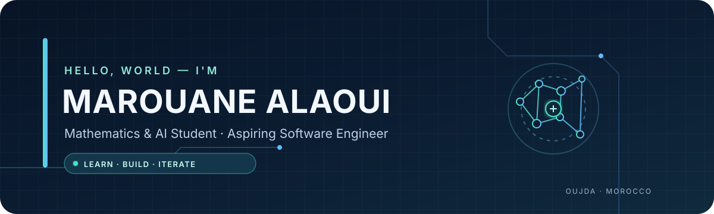

<!-- Profile README: MarouaneAlaouiismaili -->

  

   

  
  
  

  <h3>Building a strong foundation. Turning curiosity into working projects.</h3>

  

    <a href="#about-me">About</a> ·
    <a href="#what-im-exploring">Focus areas</a> ·
    <a href="#featured-project">Featured project</a> ·
    <a href="#toolbox">Toolbox</a> ·
    <a href="#current-goals">Goals</a>
  

---

## About me

Hi, I'm **Marouane Alaoui**, a first-semester Mathematics and Artificial Intelligence student based in Oujda, Morocco.

I'm developing my skills at the intersection of **software engineering, artificial intelligence, data, and computer systems**. I learn by building, testing, documenting, and improving real projects—not just collecting tutorials.

- 🎓 **Currently:** S1 — Mathematics & Artificial Intelligence
- 🧠 **Interested in:** AI/ML, developer tools, data, Linux, networking, and cybersecurity
- 🛠️ **Building:** CVBN, a personal AI-powered CLI agent
- 🌱 **Learning:** Python, programming fundamentals, mathematics, Git, and maintainable software practices
- 📍 **Based in:** Oujda, Morocco

> My approach: stay curious, build small, test honestly, and improve continuously.

## What I'm exploring

<table>
  <tr>
    <td width="50%" valign="top">
      <h3>🤖 AI & Intelligent Systems</h3>
      Exploring language models, local AI workflows, and ways to build useful AI-powered developer tools.
    </td>
    <td width="50%" valign="top">
      <h3>💻 Software Engineering</h3>
      Learning Python, CLI design, debugging, testing, documentation, and project architecture through practice.
    </td>
  </tr>
  <tr>
    <td width="50%" valign="top">
      <h3>📊 Data & Machine Learning</h3>
      Building foundations in mathematics, data analysis, and machine-learning concepts.
    </td>
    <td width="50%" valign="top">
      <h3>🌐 Systems & Cybersecurity</h3>
      Practising Linux, networking, and security fundamentals in controlled learning environments.
    </td>
  </tr>
</table>

## Featured project

### CVBN — Personal AI CLI Agent

A work-in-progress project exploring a Claude-Code-like command-line workflow, with a focus on making AI useful in a local development environment.

**Direction and areas of work**
- A command-line interface for working with AI providers.
- Exploration of local-model workflows alongside hosted providers.
- Tool-driven workflows, sessions, and extensibility.
- **Bug Bounty Professionnel:** an experimental investigation workflow designed to propose focused Python programs based on evidence, with scope and permission controls.

**Status:** Actively evolving. Features, compatibility, and test coverage may change as development continues.

> I aim to document capabilities and limitations accurately. This description is a project overview, not a claim that every planned capability is production-ready.

## Toolbox

These are technologies and areas I am learning or practising; the list reflects my current learning journey rather than a claim of expert-level proficiency.

  
  
  
  
  
  
  

## Current goals

- [ ] Strengthen Python, algorithms, and mathematical foundations.
- [ ] Publish well-documented projects with clear setup and usage instructions.
- [ ] Improve testing, debugging, code quality, and software architecture.
- [ ] Experiment with local LLMs and practical AI-agent workflows.
- [ ] Build networking and cybersecurity projects in authorised environments.
- [ ] Keep project documentation, limitations, and progress transparent.

## GitHub activity

  
  
   
  

These cards are generated by third-party services and may occasionally be unavailable. Language statistics reflect public repository code, not overall skill level.

## Connect

I'm interested in learning from other developers, exchanging ideas, and collaborating on beginner-friendly open-source projects related to AI, Python, and developer tools.

- **GitHub:** [@MarouaneAlaouiismaili](https://github.com/MarouaneAlaouiismaili)
- **LinkedIn:** [Connect with me](https://www.linkedin.com/in/marouan-alaoui-ismaili-381b9a309/)

---

  <i>Curiosity into code. Ideas into experiments. Progress through practice.</i>

